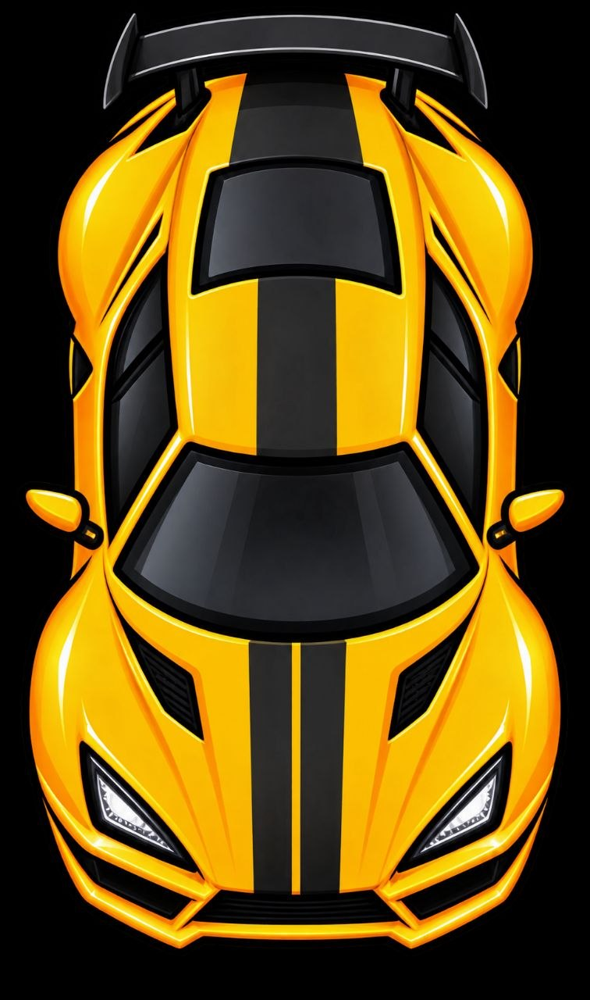
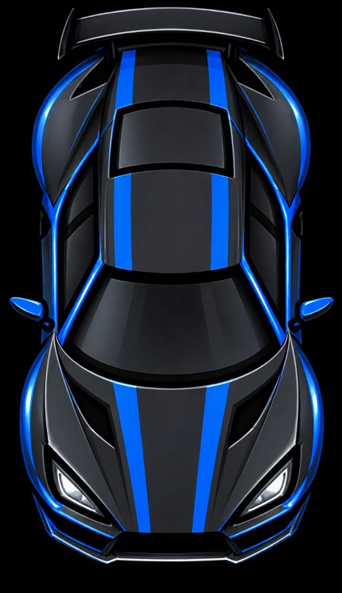
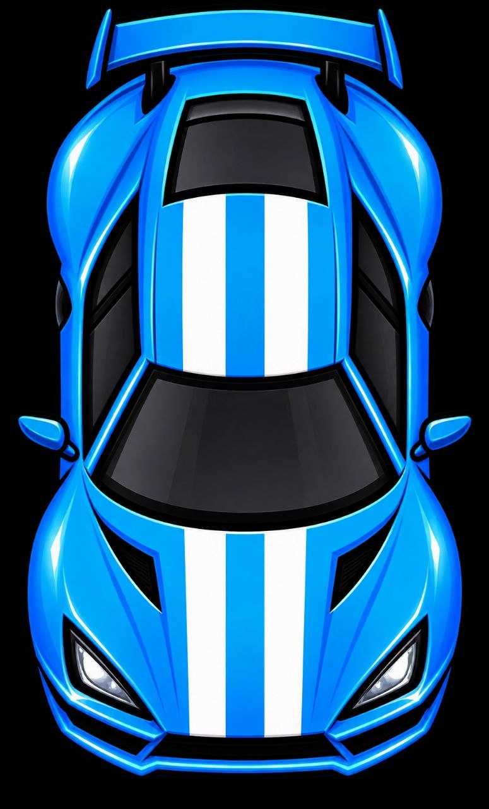
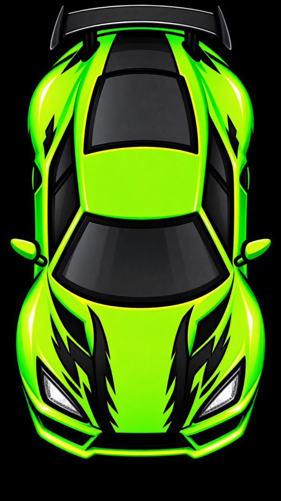

# 🏁 La Grande Course

> **Четыре разработчика. Одна мечта. Ноль бюджета.**
> Дневник разработки гоночной игры, которую мы делаем своими руками.


---

## 📖 О проекте

**La Grande Course** — аркадные гонки с видом сверху, где главное не скорость,
а стиль. Мы — команда из четырёх человек, которые по вечерам и выходным
собираются в Discord и slowly, но верно превращаем идею «а что если...»
в играбельный билд.

Проект находится **на стадии активной разработки**. Всё, что вы видите,
может сломаться, измениться или исчезнуть к утру. И это нормально.

---

## 👥 Команда

| Роль | Кто | Зона ответственности |
|------|-----|----------------------|
| 🎮 **Представитель проекта** | **Гончаренко Глеб** | Придумывает фичи |
| 💻 **Главный разработчки** | **Щерба Даниил** | Физика машин, управление |
| 🔊 **Технический специалист / Гейм-Дизайнер** | **Аблятифов Эмиль** | Музыка, билды |
| 📝 **Документация** | **Григоренко Даниил** | Ведение этого `README.md`. |

> Мы не студия. Мы — четыре человека, у которых есть **Telegram-чат** и слишком много энтузиазма.

---

## 🛠️ Технологии

- **Версионный контроль:** Git + GitHub
- **Таск-трекер:** GitHub Projects
- **Связь:** Discord + Telegram

---

## 🚧 Текущий статус разработки

### ✅ Готово
- [x] Базовое управление машиной (WASD / стрелки)
- [x] Камера, следящая за игроком
- [x] Таймер круга
- [x] Главное меню (заглушка)
- [x] # 🚗 Выбор машины

> Одна из первых вещей, которую мы решили сделать «как надо»,
> — это экран выбора автомобиля. Потому что в гонках машина — это характер.

---

## 🎮 Как это работает (в текущем билде)

При старте игрок попадает в меню **«Гараж»**, где может:

1. **Листать** доступные машины (стрелки ← →)
2. **Смотреть характеристики** (скорость, разгон, управление, дрифт)
3. **Читать описание** и «характер» болида
4. **Выбрать цвет** (3 палитры на старте)
5. **Подтвердить** выбор и поехать

Экран пока **на стадии прототипа**: спрайты — плейсхолдеры,
анимации появления — простые `Tween`. Но логика уже работает.

---

## 🏎️ Текущий автопарк

### 1. **Искра** ✨
> *«Лёгкая, дерзкая, французская.»*

| Параметр | Значение |
|----------|----------|
| Скорость | ███████░░░ 7/10 |
| Разгон | ████████░░ 8/10 |
| Управление | █████████░ 9/10 |
| Дрифт | ██████████ 10/10 |

**Стиль:** юркая малолитражка. Идеальна для поворотов и дрифта.
**Слабость:** на прямых её обгоняют все, кому не лень.
**Кто придумал:** Эмиль. 




---

### 2. **Танк** 🛡️
> *«Тяжёлый. Медленный. Неумолимый.»*

| Параметр | Значение |
|----------|----------|
| Скорость | █████████░ 9/10 |
| Разгон | █████░░░░░ 5/10 |
| Управление | ████░░░░░░ 4/10 |
| Дрифт | ███░░░░░░░ 3/10 |

**Стиль:** бронированный монстр. Разгоняется долго, но потом его не остановить.
**Слабость:** повороты — боль. Дрифт — почти невозможен.
**Кто придумал:** Эмиль. 



---

### 3. **Ракета** 🚀
> *«Прямые — её стихия. Повороты — её страх.»*

| Параметр | Значение |
|----------|----------|
| Скорость | ██████████ 10/10 |
| Разгон | █████████░ 9/10 |
| Управление | █████░░░░░ 5/10 |
| Дрифт | ██████░░░░ 6/10 |

**Стиль:** ракета на колёсах. На прямых — король. В поворотах — лотерея.
**Слабость:** чуть переборщил с газом — улетел в стену.
**Кто придумал:** Эмиль. 



---

### 4. **Хамелеон** 🦎 
> *«Универсал без слабых мест. И без ярких сильных.»*

| Параметр | Значение |
|----------|----------|
| Скорость | ███████░░░ 7/10 |
| Разгон | ███████░░░ 7/10 |
| Управление | ███████░░░ 7/10 |
| Дрифт | ███████░░░ 7/10 |

**Стиль:** сбалансированная машина для новичков.
**Статус:** спрайт в работе у Лены, физика — заглушка.
**Кто придумал:** Эмиль. 



---

## 📊 Сравнительная таблица

| Машина | Скорость | Разгон | Управление | Дрифт | Сложность |
|--------|:--------:|:------:|:----------:|:-----:|:---------:|
| 🥖 La Baguette | 7 | 8 | 9 | 10 | Легко |
| 🛡️ Le Tank | 9 | 5 | 4 | 3 | Сложно |
| 🚀 La Fusée | 10 | 9 | 5 | 6 | Средне |
| 🦎 Le Caméléon | 7 | 7 | 7 | 7 | Легко |

> ⚠️ Цифры — **временные**. Баланс крутится каждую неделю,

---

## 🎨 Кастомизация (в планах)

- [x] Выбор цвета кузова (3 палитры)
- [x] Разблокировка машин за очки

---

### 🔄 В работе
- [x] Система чекпоинтов и кругов
- [x] Мини-карта
- [x] Таблица рекордов (локальная)
- [x] Камера, слежка за авто

### 🧊 В бэклоге
- [x] Кастомизация машин
- [x] Музыка и динамический саундтрек

---

## 🚀 Как запустить (для смелых)

> ⚠️ Внимание: это **не финальная версия**. Многое работает через костыли.

```bash
# 1. Клонируем репозиторий
https://github.com/Tigrib35/The_Coolest_Race_Ever_Created
cd la-grande-course

# 2. Открываем в Godot 4.x
# (File → Import → выбираем project.godot)

# 3. Жмём F5 и надеемся
