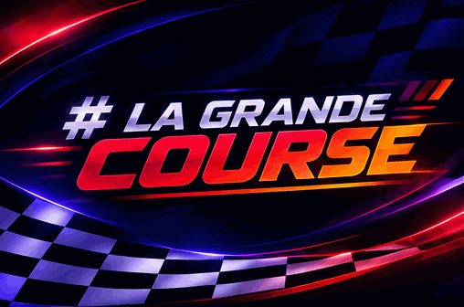

<div align="center">

<div align="center">
  
</div>

<br>

# 🏁 LA GRANDE COURSE

### **Скорость • Стиль • Дрифт**

</div>

---

# 🏎️ О ПРОЕКТЕ

Здесь дальше уже идёт остальной текст README...

**La Grande Course** — аркадная гоночная игра с видом сверху, в которой игрок выбирает автомобиль и соревнуется на гоночных трассах.

Главная особенность игры — у каждого автомобиля собственные характеристики:

- 🏎️ Максимальная скорость
- 🚀 Ускорение
- 🎯 Управление

Поэтому выбор машины напрямую влияет на стиль прохождения трассы.

> ⚠️ Проект находится в активной разработке. Характеристики автомобилей и игровые механики могут изменяться.

---

# 🚗 АВТОМОБИЛИ

В текущей версии игры доступны **4 автомобиля**.

| Автомобиль | 🏎️ Скорость | 🚀 Ускорение | 🎯 Управление |
|:---:|:---:|:---:|:---:|
| 🖤 **SHADOW** | **220** | 7/10 | **9/10** |
| 💚 **VENOM** | **230** | **9/10** | 6/10 |
| ❤️ **INFERNO** | **260** | 8/10 | 7/10 |
| 💛 **FLASH** | **210** | **10/10** | **9/10** |

---

## 🖤 SHADOW

> **Тёмный хищник. Отлично держит дорогу и уверенно проходит повороты.**

| Характеристика | Значение |
|---|:---:|
| 🏎️ Скорость | **220** |
| 🚀 Ускорение | **7/10** |
| 🎯 Управление | **9/10** |

### Особенности

SHADOW — автомобиль, ориентированный на стабильное управление.

Благодаря управлению **9/10** он отлично подходит для трасс с большим количеством поворотов.

**Лучший выбор для:**

- 🎯 точного управления;
- 🛣️ извилистых трасс;
- 🏁 стабильной езды.

---

## 💚 VENOM

> **Агрессивный автомобиль с мощным ускорением.**

| Характеристика | Значение |
|---|:---:|
| 🏎️ Скорость | **230** |
| 🚀 Ускорение | **9/10** |
| 🎯 Управление | **6/10** |

### Особенности

VENOM делает ставку на мощное ускорение.

Он быстро набирает скорость, но управление требует большей аккуратности.

**Лучший выбор для:**

- 🚀 быстрых стартов;
- 💨 резкого ускорения;
- 🔥 агрессивного стиля езды.

---

## ❤️ INFERNO

> **Настоящий уличный хищник с высокой максимальной скоростью.**

| Характеристика | Значение |
|---|:---:|
| 🏎️ Скорость | **260** |
| 🚀 Ускорение | **8/10** |
| 🎯 Управление | **7/10** |

### Особенности

INFERNO — автомобиль с самой высокой максимальной скоростью среди четырёх машин.

**260 скорости** делают его особенно эффективным на длинных прямых.

**Лучший выбор для:**

- 🏎️ высокой максимальной скорости;
- 🛣️ длинных прямых;
- 🏆 борьбы за лучшее время.

---

## 💛 FLASH

> **Лёгкий и манёвренный автомобиль с быстрым ускорением.**

| Характеристика | Значение |
|---|:---:|
| 🏎️ Скорость | **210** |
| 🚀 Ускорение | **10/10** |
| 🎯 Управление | **9/10** |

### Особенности

FLASH обладает самым высоким ускорением среди всех автомобилей.

Несмотря на максимальную скорость **210**, он очень быстро набирает скорость и отлично управляется.

**Лучший выбор для:**

- 💨 быстрых разгонов;
- 🎯 сложных поворотов;
- 🌀 манёвров;
- 🏁 технических трасс.

---

# 📊 СРАВНЕНИЕ АВТОМОБИЛЕЙ

<div align="center">

| 🚗 Машина | 🏎️ Скорость | 🚀 Ускорение | 🎯 Управление |
|:---:|:---:|:---:|:---:|
| 🖤 **SHADOW** | 220 | 7/10 | **9/10** |
| 💚 **VENOM** | 230 | **9/10** | 6/10 |
| ❤️ **INFERNO** | **260** | 8/10 | 7/10 |
| 💛 **FLASH** | 210 | **10/10** | **9/10** |

</div>

---

# 🏆 КАКУЮ МАШИНУ ВЫБРАТЬ?

### 🏎️ Нужна максимальная скорость?

## ❤️ INFERNO

**260** — лучший показатель максимальной скорости.

---

### 🚀 Нужен самый быстрый разгон?

## 💛 FLASH

**10/10** ускорения — лучший показатель в игре.

---

### 🎯 Нужна хорошая управляемость?

## 🖤 SHADOW или 💛 FLASH

Обе машины имеют управление **9/10**.

---

### 🔥 Нужен мощный старт?

## 💚 VENOM

Ускорение **9/10** позволяет быстро набирать скорость.

---

# 🎮 УПРАВЛЕНИЕ

| Клавиша | Действие |
|:---:|:---|
| `W` / `↑` | 🟢 Газ |
| `S` / `↓` | 🔴 Тормоз / движение назад |
| `A` / `←` | ◀️ Поворот влево |
| `D` / `→` | ▶️ Поворот вправо |

> Управление может изменяться по мере разработки проекта.

---

# 🏁 ИГРОВОЙ ПРОЦЕСС

```text
                    🏁 LA GRANDE COURSE
                           │
                           ▼
                    ┌─────────────┐
                    │  🚗 ГАРАЖ   │
                    └──────┬──────┘
                           │
                           ▼
                    ┌─────────────┐
                    │ ВЫБОР МАШИНЫ│
                    └──────┬──────┘
                           │
          ┌────────────────┼────────────────┐
          ▼                ▼                ▼
       SHADOW           VENOM            INFERNO
          │                │                │
          └────────────────┼────────────────┘
                           │
                           ▼
                    ┌─────────────┐
                    │  🏁 ГОНКА   │
                    └──────┬──────┘
                           │
                           ▼
                    ┌─────────────┐
                    │  🏆 РЕКОРД  │
                    └─────────────┘
```

---

# ⚡ ОСОБЕННОСТИ

- 🏎️ **4 уникальных автомобиля**
- 🛣️ Гоночные трассы
- 🎯 Разные характеристики машин
- 🚀 Различное ускорение
- 🏎️ Разная максимальная скорость
- 🎯 Разное управление
- ⏱️ Таймер круга
- 🏁 Система кругов
- 📍 Чекпоинты
- 🗺️ Мини-карта
- 🏆 Локальная таблица рекордов
- 🎨 Выбор автомобиля
- 🎵 Музыкальное сопровождение

---

# 🎨 КАСТОМИЗАЦИЯ

### ✅ Реализовано

- [x] Выбор автомобиля
- [x] Выбор цвета автомобиля
- [x] Разные характеристики автомобилей
- [x] Система выбора автомобиля

### 🔨 В разработке

- [ ] Дополнительные цвета
- [ ] Расширенная кастомизация
- [ ] Визуальный тюнинг
- [ ] Новые варианты автомобилей

---

# 🚧 ROADMAP

## 🟢 ГОТОВО

- [x] Базовое управление автомобилем
- [x] Камера
- [x] Выбор автомобиля
- [x] Четыре автомобиля
- [x] Уникальные характеристики машин
- [x] Таймер круга
- [x] Чекпоинты
- [x] Система кругов
- [x] Мини-карта
- [x] Локальные рекорды
- [x] Выбор цвета автомобиля

## 🟡 В РАЗРАБОТКЕ

- [ ] Улучшение физики
- [ ] Баланс автомобилей
- [ ] Новые трассы
- [ ] Новые автомобили
- [ ] Улучшение графики
- [ ] Звуковые эффекты
- [ ] Музыкальная система

## 🔴 В ПЛАНАХ

- [ ] Больше автомобилей
- [ ] Больше трасс
- [ ] Новые игровые режимы
- [ ] Расширенная кастомизация
- [ ] Улучшенная система рекордов
- [ ] Дополнительные игровые механики

---

# 🛠️ ИНСТРУМЕНТЫ

| Инструмент | Использование |
|:---|:---|
| 🔧 **Git** | Контроль версий |
| 🐙 **GitHub** | Хранение исходного кода |
| 📋 **GitHub Projects** | Планирование задач |
| 💬 **Discord** | Общение команды |
| 📱 **Telegram** | Командный чат |

---

# 👥 КОМАНДА

| Роль | Участник |
|:---|:---|
| 🎮 Представитель проекта | **Гончаренко Глеб** |
| 💻 Главный разработчик | **Щерба Даниил** |
| 🔊 Технический специалист / гейм-дизайнер | **Аблятифов Эмиль** |
| 📝 Документация | **Григоренко Даниил** |

---

# 📈 СТАТУС ПРОЕКТА

<div align="center">

## 🔥 ACTIVE DEVELOPMENT

**La Grande Course** продолжает активно разрабатываться.

Новые автомобили, трассы, игровые механики и улучшения будут добавляться по мере развития проекта.

</div>

---

<div align="center">

# 🏁 LA GRANDE COURSE

### **Выбери свой автомобиль.**

### **Нажми на газ.**

### **Оставь свой рекорд.**

<br>

**🖤 SHADOW • 💚 VENOM • ❤️ INFERNO • 💛 FLASH**

<br><br>

## 🏎️💨 SEE YOU ON THE TRACK! 🏁

</div>
